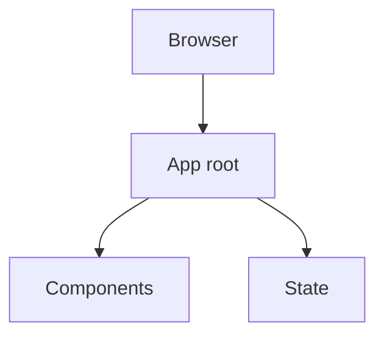

<div align="center">


### React Chatbotify

<br>

[](https://react.dev) [](https://www.typescriptlang.org) [](https://vite.dev)

  

</div>

---

## What this is

React 18 site with 17 components. Also checked in: 3 test files and 2 markdown documents. The sections below are read from the repository itself, 88 tracked files as of 2023-11-13.

The code is laid out as:

- `src/components/` — UI components
- `src/assets/` — assets
- `src/services/` — service layer
- `src/types/` — type definitions
- `src/context/` — React context
- `test/` — tests
- `types/` — type definitions
- `docs/` — documentation

<div align="center">

|  |  |  |
|:--:|:--:|:--:|
| **17** | **3** | **2** |
| components | test files | docs |

</div>

---

## Architecture



<sub>Derived from the directories present in this repository.</sub>

---

## Stack

| Layer | Choice |
|---|---|
| [React](https://react.dev) | v18.2 |
| [TypeScript](https://www.typescriptlang.org) | v5.1 |
| [Vite](https://vite.dev) | v4.5 |

---

## Getting started

```bash
git clone https://github.com/gowtham-creator/AI-chatbot-.git
cd AI-chatbot-
npm install
npm run start
```

### Scripts

| Command | Runs |
|---|---|
| `npm run start` | `vite serve` |
| `npm run build` | `tsc && vite build && cp ./dist/index.d.ts ./dist/index.d.cts` |
| `npm run lint` | `eslint . --ext .tsx` |
| `npm run test` | `node ./test/RunTests.js` |
| `npm run prepublishOnly` | `tsc && vite build && cp ./dist/index.d.ts ./dist/index.d.cts` |
| `npm run prepack` | `tsc && vite build && cp ./dist/index.d.ts ./dist/index.d.cts` |

---

## Project structure

| Path | Contents | Files |
|---|---|---|
| `src/components/` | UI components | 33 |
| `src/assets/` | assets | 15 |
| `src/services/` | service layer | 13 |
| `src/` | — | 5 |
| `src/types/` | type definitions | 5 |
| `src/context/` | React context | 3 |
| `test/` | tests | 3 |
| `types/` | type definitions | 2 |
| `docs/` | documentation | 1 |

<sub>88 tracked files in total.</sub>

---

<div align="center">
<sub><a href="https://github.com/gowtham-creator/AI-chatbot-">gowtham-creator/AI-chatbot-</a></sub>
</div>
